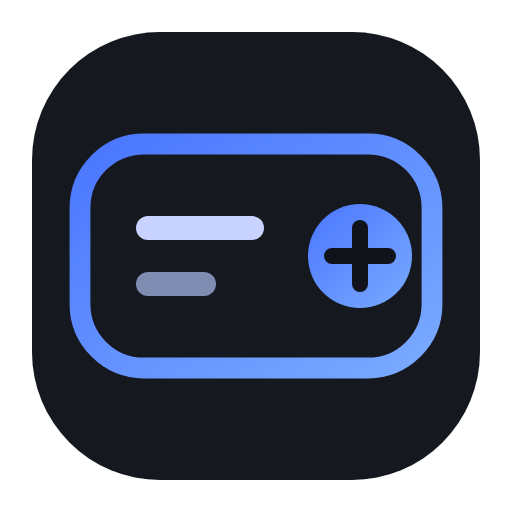
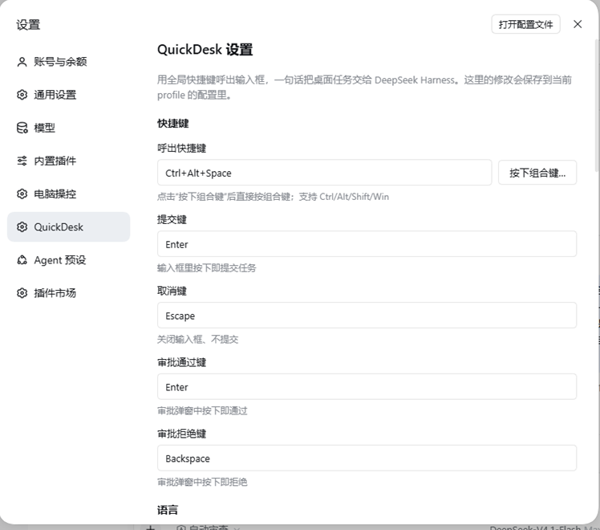
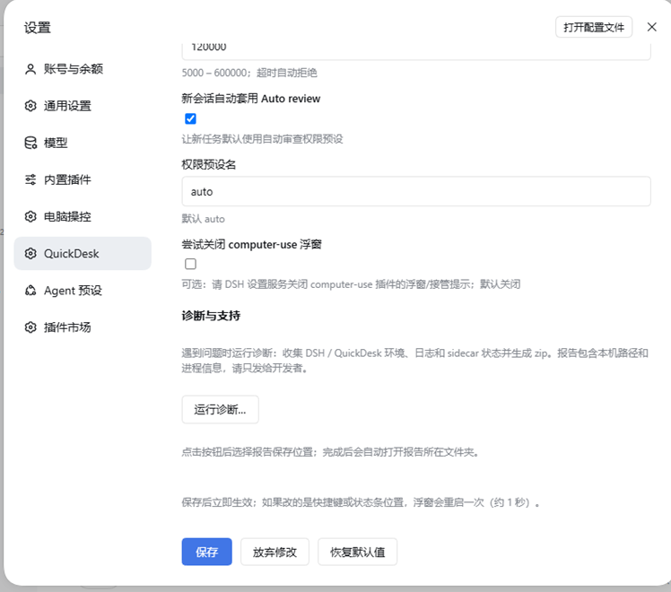
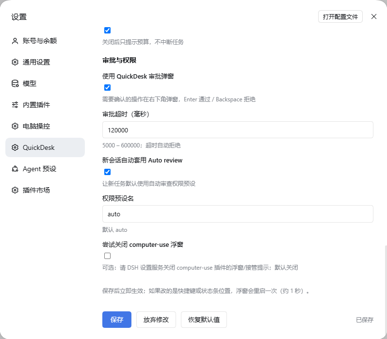

<p align="center">
  
</p>

# QuickDesk

[](https://github.com/aofchas/dsh-quickdesk/actions/workflows/ci.yml)
[](https://www.npmjs.com/package/dsh-quickdesk)
[](LICENSE)
[](https://dsh-plugin.org/plugins/aofchas/dsh-quickdesk)

**English** · [简体中文](README.md)

**QuickDesk** is an installable, distributable desktop-assistant plugin for DeepSeek Harness. It packages the whole
“global hotkey → one-sentence task → desktop computer-use execution” loop as a standalone plugin:
shortcuts, language, task protocol and status HUD are all editable on the **DSH settings page** — no YAML editing required.

> **Platform**: Windows 10/11 + PowerShell 5.1 (Windows-only)
>
> **Environment**: DSH Desktop 0.2.2-rc.3 tested (rc.1 or newer)
>
> **Requires**: [`dsh-computer-use-win`](https://github.com/yu-tao-li/dsh-computer-use-win) or another computer-use
> provider that exposes desktop tools, as the desktop execution backend

> Repository: <https://github.com/aofchas/dsh-quickdesk> (Windows only, PowerShell 5.1 + WinForms)

## Features

1. **Global hotkey**: `Ctrl+Alt+Space` by default; press the combination you want directly in Settings to capture it. Summon a translucent input box from any foreground app, submit with the configured key, close with the cancel key.
2. **DSH settings page**: Settings → Plugins → QuickDesk lets you edit shortcuts, language, status HUD, workspace, task protocol, step budget and approval options; saving writes into the active profile configuration, so you never edit `cordis.patch.yml` by hand.
3. **Completion-first task protocol**: every task is prefixed with built-in instructions (chosen from `locale/<language>.json` → `prompt`):
   - **Stop when done**: once the requested state exists (results page loaded / text typed / file saved), stop — no more scrolling, screenshots or page reading;
   - **No summary by default**: reply with exactly one line; unless the user explicitly asks to “tell me / summarize / list the content”, never restate page content;
   - **Step budget**: aim for ≤10 steps; the plugin cancels the turn after `maxSteps` (default 20);
   - **Tool discipline**: UIA first, at most 2 screenshots as a fallback, and no `pwsh` / `grep` / `read` file tools for page content;
   - Web tasks still use the **user-visible Chrome**, and irreversible actions ask the user first.
4. **Bilingual (zh/en)**: `language: auto` follows the OS language (Chinese system → Chinese, otherwise English), or force `zh` / `en`; the input box, status HUD, approval popup, settings page and task protocol share the same locale data.
5. **One-line status HUD**: an always-on-top, click-through status line; shows “step N/20 · action” while running and “Done · N steps · Xs” when finished; a budget stop reads “Stopped · over the 20-step budget”.
6. **Approval popup**: confirmation requests appear in the bottom-right corner; Enter approves, Backspace rejects by default, and both keys are configurable.
7. **Desktop-backend self-check**: before submitting a task, QuickDesk verifies that desktop computer-use tools are registered; if `dsh-computer-use-win` (or another desktop provider) is missing, it shows a hint instead of burning a session.
8. **Auto review preset for new sessions**; tasks are created in the default workspace.
9. **One-click diagnostics in Settings**: Settings → Plugins → QuickDesk → Diagnostics and support lets you choose where to save a report zip; it collects the environment, DSH profiles, `launcher.log`, sidecar state, PowerShell prerequisites and recent DSH logs, then deletes the temporary collection folder.

## Why QuickDesk

For the same “let the AI operate my desktop” job, QuickDesk targets the two most practical problems: **the entry point and the token cost**.

- **No chat window, no long prompt**: press your configured hotkey (defaults to `Ctrl+Alt+Space`) from any foreground app, say one sentence and it runs; the task lives in its own session, so your current conversation is untouched.
- **Billed on “done”, not on “summary”**: stop when done, one-line reply, no page recap by default; the same YouTube search task dropped from **53 tool calls to about 10 steps** (12 screenshots → ≤2).
- **The step budget is a hard limit**: exceeding `maxSteps` cancels the turn (default 20); the model cannot burn tokens on endless verification or scrolling, and the HUD tells you why it stopped.
- **No coordinate guessing**: UIA-first with screenshot fallback removes most of the “screenshot → read pixels → click” loop.
- **Bilingual by default**: UI, status line, approval popup and task protocol are all localized, so English users are productive out of the box.
- **Installable, visible, stoppable**: visual configuration in the DSH settings page; the HUD shows steps and elapsed time; the approval popup hands irreversible actions back to you.
- **No hijacking of other plugins**: QuickDesk never imports or modifies the computer-use plugin and never silently changes another plugin’s settings; a missing desktop backend is reported explicitly.

## Screenshots

Settings → Plugins → QuickDesk — every option is editable from the UI:







## Installation

Requirements: Windows 10/11, PowerShell 5.1, DSH (`web` or `desktop` profile; tested with 0.2.2-rc.3, rc.1 or newer), and a computer-use plugin that
provides desktop tools (recommended: [`dsh-computer-use-win`](https://github.com/yu-tao-li/dsh-computer-use-win)).

Install from npm (recommended):

```powershell
# Web profile (common)
dsh plugin --profile web add dsh-quickdesk

# DSH Desktop can also install into the desktop profile
dsh plugin --profile desktop add dsh-quickdesk
```

Alternatively, download `dsh-quickdesk-1.2.1.tgz` from the GitHub Release and use “Plugins → Add plugin”
in DSH, or install from a local checkout (run inside the repository root; replacing `.` with the clone path also works):

```powershell
dsh plugin --profile desktop add .
```

**Fully quit and restart DSH** after installing or upgrading. Then open Settings → Plugins → QuickDesk to configure everything visually.

## Release notes

- Changelog: [CHANGELOG.md](https://github.com/aofchas/dsh-quickdesk/blob/main/CHANGELOG.md)
- 1.2.1 release notes: [docs/release-notes/1.2.1.md](https://github.com/aofchas/dsh-quickdesk/blob/main/docs/release-notes/1.2.1.md)

## Configuration

### Edit in the DSH settings page (recommended)

After restarting DSH, open Settings → Plugins → QuickDesk: shortcuts, language, status HUD, workspace, task protocol, step budget and approval options are all editable. Saving writes into the active profile configuration layer (the `quickdesk` row of `cordis.patch.yml`) and survives restarts. Most changes apply **immediately**; only shortcut or HUD-corner changes restart the overlay sidecar for about one second.

### Override through the profile patch (advanced / distribution defaults)

To lock defaults, distribute in bulk or run GitOps, you can still replace the whole `id: quickdesk` config in `~/.dsh/profiles/<profile>/cordis.patch.yml` (the loader replaces the entire row; omitted fields fall back to the plugin defaults):

```yaml
- id: quickdesk
  name: dsh-quickdesk
  config:
    hotkey: Ctrl+Alt+Space
    submitKey: Enter
    cancelKey: Escape
    approveKey: Enter
    rejectKey: Backspace
    language: auto
    statusCorner: top-right
    statusEnabled: true
    statusLingerMs: 20000
    workspaceDirectory: ""
    defaultPrompt: ""
    maxSteps: 20
    enforceMaxSteps: true
    approvalPopup: true
    popupTimeoutMs: 120000
    autoPresetNewSessions: true
    autoPresetName: auto
    disableComputerUseUi: false
```

### Shortcut fields

| Field | Default | Purpose |
|---|---|---|
| `hotkey` | `Ctrl+Alt+Space` | Summon / hide the input box (Ctrl/Alt/Shift/Win plus letters/digits/F1–F24/Space etc.) |
| `submitKey` | `Enter` | Submit the task (combinations such as `Ctrl+Enter` are allowed) |
| `cancelKey` | `Escape` | Close the input box |
| `approveKey` | `Enter` | Approve in the approval popup |
| `rejectKey` | `Backspace` | Reject in the approval popup |

### Other fields

| Field | Default | Meaning |
|---|---|---|
| `language` | `auto` | `auto` follows the OS language; `zh` / `en` force a language (also selects the built-in task protocol) |
| `statusCorner` | `top-right` | HUD corner: `top-right` / `top-left` / `bottom-right` / `bottom-left` |
| `statusEnabled` | `true` | Show the one-line status HUD |
| `statusLingerMs` | `20000` | How long the final status stays visible |
| `workspaceDirectory` | empty | Workspace for new sessions; empty = DSH default |
| `maxSteps` | `20` | Tool-call budget per task; exceeding it cancels the turn (range 5–200) |
| `enforceMaxSteps` | `true` | Enforce the budget; `false` keeps it prompt-only |
| `defaultPrompt` | empty | Empty = built-in protocol for the active language; otherwise it replaces it and may use `{{MAX_STEPS}}` |
| `approvalPopup` | `true` | Take over approval requests with the QuickDesk popup |
| `popupTimeoutMs` | `120000` | Approval timeout (auto-reject) |
| `autoPresetNewSessions` | `true` | Apply the Auto review permission preset to new sessions |
| `autoPresetName` | `auto` | Permission preset name |
| `disableComputerUseUi` | `false` | Optional: try to turn off computer-use-win’s overlay/takeover hint via the DSH settings service (host-side best effort, off by default) |
| `diagnosticsRequest` | empty | Host-owned: request token written by the settings-page button (do not edit) |

> Every field above can be edited directly in the DSH settings page; this table documents defaults, ranges and semantics for distribution defaults and troubleshooting. `diagnosticsRequest` is maintained by the settings-page button and normally needs no manual edits.

### Language and copy

- All user-visible copy lives in [`locale/zh.json`](locale/zh.json) and [`locale/en.json`](locale/en.json):
  `meta.title` / `meta.description` (read by DSH Plugin Manager), `ui.*` (input box, status HUD, approval popup) and `prompt` (default task protocol).
- The settings page copy lives in `dictionaries` inside [`client.js`](client.js) (also zh/en) and follows the same wording.
- Adding a language: copy `locale/en.json` to `locale/xx.json`, set `language: xx`, and register it in `LANGUAGES` in `quickdesk.mjs` and in `dictionaries` in `client.js`.
- Custom task protocol: write it in the settings page’s “Task protocol” field, or set `defaultPrompt: |` in the profile patch; `{{MAX_STEPS}}` is replaced with the current `maxSteps`.

### Diagnostics and support

Settings → Plugins → QuickDesk → **Diagnostics and support** → **Run diagnostics...**. A native Save-As dialog lets you choose where to store the report zip; after a successful zip, the temporary collection folder is deleted automatically.

- The report contains the environment and encoding, DSH versions and profiles, the QuickDesk install, `launcher.log`, sidecar processes, PowerShell/Add-Type/mutex/hidden-startup tests, the plugin module import result and recent DSH log excerpts.
- The report can contain local paths, user names and process command lines. Treat it as private and share it only with the developer.
- Command-line alternative (`<plugin dir>` = `node_modules/dsh-quickdesk` in the profile):
  ```powershell
  powershell -NoProfile -ExecutionPolicy Bypass -File "<plugin dir>\scripts\collect-diagnostics.ps1" -OutputZip "C:\Temp\QuickDesk-Diagnostics.zip"
  ```

## Step and token optimization

Measured on the same “search YouTube for IM LS8 Neo” task, the old QuickDesk used **53 tool calls**: the search was done at step 10, and the next 30+ steps were `screenshot` + `read_image` pairs (12 screenshots, 12 image reads) plus `scroll` / `grep` / `pwsh`, all to write a page summary.

| Change | Effect |
|---|---|
| Protocol now says “stop when done + no summary by default + one-line reply” | Ends as soon as the target state exists, instead of reading the page to write a summary |
| Protocol forbids using `pwsh` / `grep` / `read` for page content | Removes parsing tool output and enumerating results |
| Screenshot budget: at most 2 per task, only when UIA cannot read the target | Old: 12 screenshots → expected ≤2 |
| Hard `maxSteps` budget (default 20, cancels the turn) | The model is stopped even if it wants to continue; the HUD shows “Stopped · over the 20-step budget” |
| Prefer `find` / `element_info` instead of whole-tree `accessibility_tree` dumps | Avoids tens-of-KB tree dumps |

Tuning:

- Cheap tasks: `maxSteps: 12`;
- Complex forms / multi-window tasks: `maxSteps: 40`, or `enforceMaxSteps: false` (prompt-only budget);
- The default is “no page summary”; if a task really needs a content list, ask for it explicitly in the task (“list / summarize / tell me the content”).

## Working with dsh-computer-use-win

- QuickDesk **does not import or modify** the computer-use plugin; it only checks the DSH tool registry for desktop tools.
- Before submitting a task it checks for tools such as `mcp__*__list_windows`; when they are missing, the HUD shows
  “No desktop tools detected · install dsh-computer-use-win first” and no session is started.
- To hide the computer-use plugin’s own overlay/takeover hint:
  - recommended: turn them off on its settings page (`progressOverlayEnabled` / `indicatorEnabled` / `cursorIndicatorEnabled`);
  - or set `disableComputerUseUi: true` so QuickDesk attempts it at startup; current DSH rejects that write during HMR activation, in which case QuickDesk only logs a warning and everything else keeps working.

## UIA-first and the local skill

The default prompt tells the model to prefer UIA semantics. The repository also ships a local
UIA playbook: [skills/uia/SKILL.md](skills/uia/SKILL.md) (tool mapping, UIA patterns, fallback ladder,
Microsoft docs links) that you can provide to sessions or use as a team convention.

## Decoupled design (keeps working across DSH / computer-use plugin upgrades)

- **Imports no DSH runtime package and no `dsh-computer-use-win`**; every DSH interaction lives in `compat.mjs` and uses services dynamically via `ctx.get`.
- **No hard service injection**: when `sessionController`, `permissionPresets`, `approval` or `tools` are missing, the plugin still loads; only the corresponding capability degrades and a warning is logged.
- **One entry point for task creation**: `submitTask()` in `compat.mjs`. If a DSH upgrade changes `sessionController.create/prompt`, only that function needs a change (see [COMPATIBILITY.md](COMPATIBILITY.md)).
- **Generic tool-name handling**: the HUD and the desktop-backend check only strip the `mcp__<server>__` prefix and do not assume wincu; any computer-use provider works.
- **Copy is data**: UI text and the task protocol live in `locale/*.json`; changing wording needs no code change.
- **The settings page uses the standard Config mechanism**: the host exports a schemastery `Config` schema, the DSH settings service exposes the `quickdesk` namespace, and `client.js` only renders the form and submits field patches. A DSH without the settings service degrades to YAML configuration while the plugin remains usable.
- **Independent UI**: input box, status HUD and approval popup are separate PowerShell processes, decoupled from the DSH process; DSH upgrades do not affect them.

## Development and self-test

```powershell
npm test                 # full suite: encoding, PowerShell parse/GB2312, module, package, diagnostics, sidecar runtime
npm run test:unit        # 44 offline checks
node --check client.js   # settings-page client syntax
```

## When the hotkey does not work

- Logs are in `%LOCALAPPDATA%\dsh-quickdesk\launcher.log`:
  - `RegisterHotKey registered=True` + `low-level hook installed=True` means both hotkey paths are active;
  - after pressing the hotkey you should see `hotkey fired via ...` and `input shown`; if not, the key never reached QuickDesk (common causes: the foreground window is elevated, an IME/keyboard tool intercepted it, or the sidecar is restarting with the plugin).
- QuickDesk requires DSH to run; after DSH exits the global hotkey is unavailable.
- On conflicts, change `hotkey:` in `cordis.patch.yml` (e.g. `Ctrl+Alt+K`) and reload/restart DSH.
- If you still cannot locate the problem, use Settings → Plugins → QuickDesk → Diagnostics and support → Run diagnostics and send the report to the developer.

## Known limitations

- Windows only; requires PowerShell 5.1 + WinForms (built into Windows).
- After the first install or an upgrade to a version with the settings page, fully quit and restart DSH before the page appears; afterwards changes apply immediately (shortcut/HUD-corner edits restart the overlay for about one second).
- The global hotkey only works while DSH is running.
- The HUD tracks the most recent QuickDesk task; with concurrent tasks it shows the latest one.
- Hitting the step budget cancels the turn without a completion message; raise `maxSteps` for complex tasks.
- Only one session may operate the desktop at a time (the computer-use plugin’s own mutex); tasks from other sessions fail with a hint.
- Built-in copy is Chinese and English only; other system languages fall back to English.

## Security

- The approval popup takes over every `approval/request`; set `approvalPopup: false` if you do not want that.
- The one-line HUD is always on top and click-through, so it never blocks clicks.
- When the global hotkey is taken, the sidecar logs `hotkey-unavailable`; switch to another combination.
- QuickDesk does not modify any other plugin’s settings by default; `disableComputerUseUi` is explicit opt-in.
- The task protocol is only a model instruction; it does not replace DSH’s permission policy. Keep dangerous operations behind the session permission/approval layer.
- The step budget only stops “over-budget verification/summary”; it never lowers permissions or auto-approves anything.

## License

QuickDesk is released under the **MIT License**: you may use, modify, distribute and sell it freely, provided the copyright and license notice are kept.

- Full license text: [LICENSE](LICENSE)
- Copyright: Copyright (c) 2026 aofchas (aofchas)
- Third-party notes: QuickDesk bundles no third-party runtime code; DeepSeek Harness and its client packages used at runtime follow their own licenses (see the corresponding upstream documentation).
