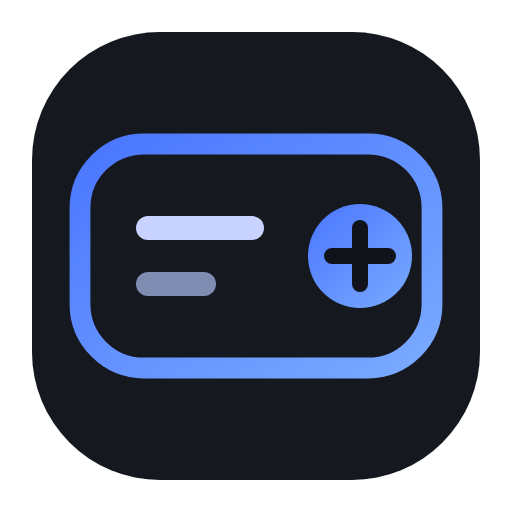
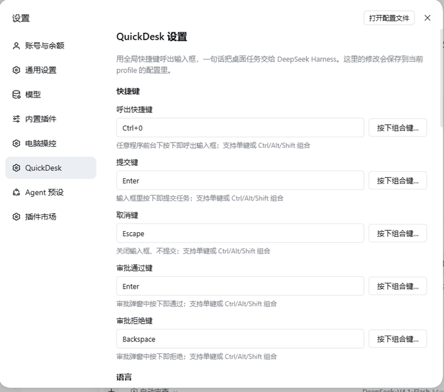
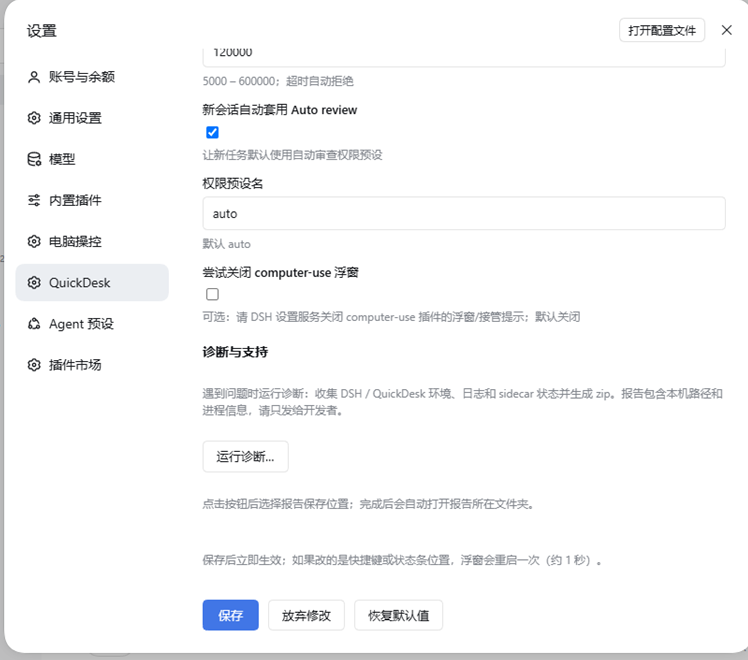
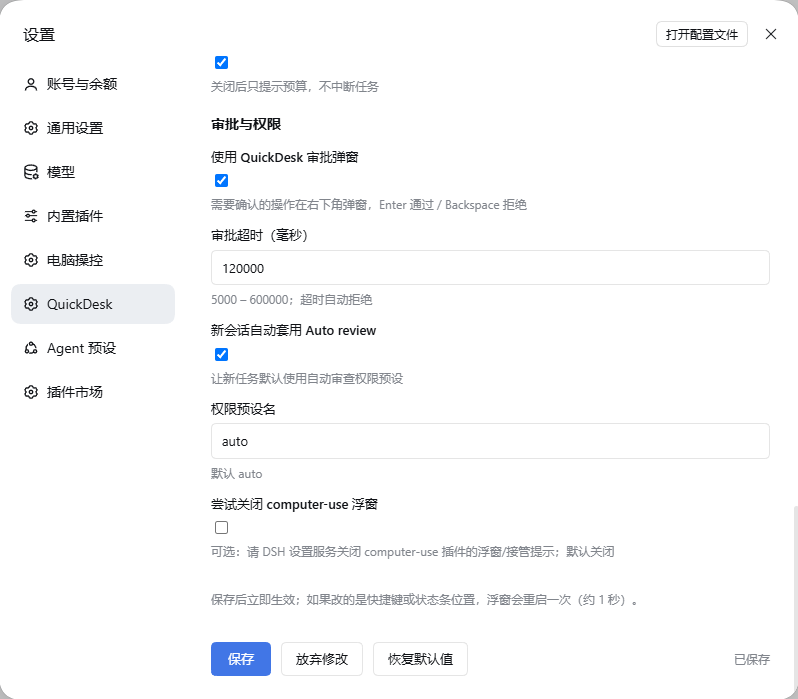

<p align="center">
  
</p>

# QuickDesk

[](https://github.com/aofchas/dsh-quickdesk/actions/workflows/ci.yml)
[](https://www.npmjs.com/package/dsh-quickdesk)
[](https://github.com/aofchas/dsh-quickdesk/blob/main/LICENSE)
[](https://dsh-plugin.org/plugins/aofchas/dsh-quickdesk)

**简体中文** · [English](https://github.com/aofchas/dsh-quickdesk/blob/main/README.en.md)

**QuickDesk**（快捷桌面）是一个可安装、可分发的 DeepSeek Harness 桌面助手插件。它把
“全局快捷键 → 一句话任务 → 桌面 computer-use 执行”的入口封装成一个独立插件包：
快捷键、语言、任务协议、状态浮窗都可以直接在 **DSH 设置页**里调整，不需要手改 YAML。

**QuickDesk** is an installable, distributable desktop-assistant plugin for DeepSeek Harness. It packages the
“global hotkey → one-sentence task → desktop computer-use execution” loop as a standalone plugin: shortcuts,
language, task protocol and the status HUD are all editable on the **DSH settings page** — no YAML editing required.

### 中文快速开始

- **平台**：仅 Windows 10/11（PowerShell 5.1 + WinForms）。
- **环境**：DSH Desktop 0.2.2-rc.3（rc.1 及以上）。
- **依赖**：`dsh-computer-use-win` 或其它提供桌面工具的 computer-use 插件。
- **安装**：`dsh plugin --profile web add dsh-quickdesk`，完成后完全退出并重启 DSH。
- **配置**：设置 → Plugins → QuickDesk；修改即时生效，无需手改 YAML。
- **诊断**：设置 → Plugins → QuickDesk → 诊断与支持，选择报告 zip 的保存位置。
- **完整指南**：见本页下方「安装」与「配置」章节。

### English quick start

- **Platform**: Windows 10/11 only (PowerShell 5.1 + WinForms).
- **Requires**: DSH Desktop 0.2.2-rc.3 (rc.1 or newer) and `dsh-computer-use-win`, or another desktop computer-use provider.
- **Install**: `dsh plugin --profile web add dsh-quickdesk`, then fully quit and restart DSH.
- **Configure**: Settings → Plugins → QuickDesk; changes apply live, no YAML editing.
- **Diagnostics**: Settings → Plugins → QuickDesk → Diagnostics and support; choose where to save the report zip.
- **Full English guide**: [README.en.md](https://github.com/aofchas/dsh-quickdesk/blob/main/README.en.md).

## 功能

1. **全局快捷键**：默认 `Ctrl+Alt+Space`；五个快捷键（呼出、提交、取消、审批通过、审批拒绝）都可以在设置页点击「按下组合键…」直接录入，支持单键或 Ctrl/Alt/Shift 组合。高风险单键会给出提示；同组冲突会阻止保存并支持「交换两者」，呼出快捷键与其它快捷键冲突时不允许保存。再次点击按钮或点击别处取消录入，Esc 也可作为普通按键录入。任何程序前台下呼出半透明输入框，按配置的提交键执行，取消键关闭。
2. **DSH 设置页**：设置 → Plugins → QuickDesk，直接修改快捷键、语言、状态浮窗、工作目录、任务协议、步数预算、审批选项；保存写入当前 profile 的配置，无需编辑 `cordis.patch.yml`。
3. **完成优先的任务协议**：每条任务前自动附加内置说明（按语言取 `locale/<language>.json` 的 `prompt`）：
   - **完成即停**：目标状态出现（结果页已加载 / 文字已输入 / 文件已保存）就结束，不再滚动、截图、读取页面；
   - **默认不写总结**：最终只回 1 行结果；除非用户明确要求“告诉我/总结/列出内容”，否则禁止复述页面内容；
   - **步数预算**：目标 10 步内完成，插件在 `maxSteps` 步后强制中止（默认 20）；
   - **工具纪律**：UIA 优先、截图最多 2 张且仅兜底、禁止用 `pwsh`/`grep`/`read` 等文件工具处理页面内容；
   - 仍然要求用**用户可见的 Chrome** 操作网页，不可逆动作前先询问。
4. **中英双语**：`language: auto` 跟随系统语言（中文系统用中文，其他用英文），也可强制 `zh` / `en`；输入框、状态浮窗、审批弹窗、设置页和任务协议都走同一套文案。
5. **单行状态浮窗**：置顶、鼠标穿透的一行状态条；运行中显示“第 N/20 步 · 动作”，结束显示“已完成 · N 步 · X 秒”；超过步数上限显示“已停止 · 超过 20 步上限”。
6. **审批弹窗**：需要确认的操作在右下角弹出，默认 Enter 通过、Backspace 拒绝；按键也可配置。
7. **桌面后端自检**：提交任务前确认已注册桌面 computer-use 工具；没有安装 `dsh-computer-use-win`（或其他桌面工具提供方）时直接提示，不浪费一轮会话。
8. **新会话默认自动审查（Auto review）**，任务在默认工作区创建。
9. **设置页一键诊断**：设置 → Plugins → QuickDesk → 诊断与支持，可在弹窗中选择报告保存位置；报告收集环境、DSH profile、launcher.log、sidecar 状态、PowerShell 前置条件与近期 DSH 日志，zip 生成后自动删除临时收集目录。

## 为什么是 QuickDesk

同样是“让 AI 操作桌面”，QuickDesk 解决的是**调用入口和 token 成本**这两个最实际的问题：

- **不用打开聊天窗口写 prompt**：按配置的呼出快捷键（默认 `Ctrl+Alt+Space`），说一句话就执行；任务跑在独立会话里，不打断你当前的对话。
- **按“完成”而不是“总结”结账**：默认完成即停、只回 1 行、页面内容不赘述；同一个 YouTube 搜索任务从 **53 次工具调用降到约 10 步**（12 张截图 → ≤2 张）。
- **步数预算是硬约束**：`maxSteps` 超限直接取消本轮（默认 20），模型没法靠无限验证/翻页烧 token；HUD 会显示停止原因。
- **桌面操作不靠猜坐标**：UIA 优先 + 截图兜底，减少“截图→看像素→点击”的循环。
- **中英双语自动切换**：界面、状态条、审批弹窗、任务协议全部本地化，英文用户开箱即用。
- **装得上、看得见、停得下**：DSH 设置页可视化配置；单行 HUD 显示步数/耗时；审批弹窗把不可逆操作交回给你。
- **不绑架其他插件**：不 import、不修改 computer-use 插件，也不偷偷改别人的设置；桌面后端缺失时明确提示。

## 界面

设置 → Plugins → QuickDesk，所有选项可视化编辑：







## 安装

要求：Windows 10/11、PowerShell 5.1、DSH（`web` 或 `desktop` profile；0.2.2-rc.3 实测，rc.1 及以上），以及一个提供桌面工具的
computer-use 插件（推荐 [`dsh-computer-use-win`](https://github.com/yu-tao-li/dsh-computer-use-win)）。

从 npm 安装（推荐）：

```powershell
# Web profile（常用）
dsh plugin --profile web add dsh-quickdesk

# DSH Desktop 也可以装到 desktop profile
dsh plugin --profile desktop add dsh-quickdesk
```

也可以从 GitHub Release 下载 `dsh-quickdesk-1.2.3.tgz`，在 DSH「插件 → 添加插件」中选择安装，
或从本地源码目录安装（在仓库根目录执行，把 `.` 换成实际克隆目录也可以）：

```powershell
dsh plugin --profile desktop add .
```

安装/升级后**完全退出并重启 DSH**。重启后在「设置 → Plugins → QuickDesk」里可视化调整所有选项。

## 版本与变更

- 变更记录：[CHANGELOG.md](https://github.com/aofchas/dsh-quickdesk/blob/main/CHANGELOG.md)
- 1.2.3 发布说明：[docs/release-notes/1.2.3.md](https://github.com/aofchas/dsh-quickdesk/blob/main/docs/release-notes/1.2.3.md)

## 配置

### 在 DSH 设置页修改（推荐）

重启 DSH 后打开「设置 → Plugins → QuickDesk」：快捷键、语言、状态浮窗、工作目录、任务协议、步数预算、审批选项都能直接编辑。保存写入当前 profile 的配置层（即 `cordis.patch.yml` 中对应的 `quickdesk` 行），下次启动继续生效；大部分改动**即时生效**，只有快捷键或状态条位置变化会让浮窗 sidecar 重启约 1 秒。

### 通过 profile patch 覆盖（高级 / 分发默认值）

需要锁定默认值、批量分发或做 GitOps 时，仍可在 `~/.dsh/profiles/<profile>/cordis.patch.yml` 整行覆盖 `id: quickdesk` 的 config（Loader 是整行替换，未写的字段会回落到插件内默认值）：

```yaml
- id: quickdesk
  name: dsh-quickdesk
  config:
    hotkey: Ctrl+Alt+Space
    submitKey: Enter
    cancelKey: Escape
    approveKey: Enter
    rejectKey: Backspace
    language: auto
    statusCorner: top-right
    statusEnabled: true
    statusLingerMs: 20000
    workspaceDirectory: ""
    defaultPrompt: ""
    maxSteps: 20
    enforceMaxSteps: true
    approvalPopup: true
    popupTimeoutMs: 120000
    autoPresetNewSessions: true
    autoPresetName: auto
    disableComputerUseUi: false
```

### 快捷键字段

| 字段 | 默认 | 作用 |
|---|---|---|
| `hotkey` | `Ctrl+Alt+Space` | 呼出 / 收起输入框（支持单键或 Ctrl/Alt/Shift 组合；设置页可直接按键录入） |
| `submitKey` | `Enter` | 提交任务（可写 `Ctrl+Enter` 这类组合键） |
| `cancelKey` | `Escape` | 关闭输入框 |
| `approveKey` | `Enter` | 审批通过 |
| `rejectKey` | `Backspace` | 审批拒绝 |

### 其他字段

| 字段 | 默认 | 含义 |
|---|---|---|
| `language` | `auto` | `auto` 跟随系统语言；`zh` / `en` 强制语言（同时决定界面文案与内置任务协议） |
| `statusCorner` | `top-right` | 状态浮窗位置：`top-right` / `top-left` / `bottom-right` / `bottom-left` |
| `statusEnabled` | `true` | 是否显示单行状态浮窗 |
| `statusLingerMs` | `20000` | 完成后保留时长 |
| `workspaceDirectory` | 空 | 新会话工作目录；空 = DSH 默认工作区 |
| `maxSteps` | `20` | 单个任务允许的工具调用步数上限；超过后 QuickDesk 直接取消这一轮（范围 5–200） |
| `enforceMaxSteps` | `true` | 是否强制执行步数上限；`false` 时只在 prompt 里提示预算 |
| `defaultPrompt` | 空 | 空 = 内置当前语言的任务协议；非空则替换它，可用 `{{MAX_STEPS}}` 占位符 |
| `approvalPopup` | `true` | 是否接管审批弹窗 |
| `popupTimeoutMs` | `120000` | 审批超时（自动拒绝） |
| `autoPresetNewSessions` | `true` | 新会话是否自动套用自动审查预设 |
| `autoPresetName` | `auto` | 预设名 |
| `disableComputerUseUi` | `false` | 可选：通过 DSH 设置服务尝试关闭 computer-use-win 的浮窗/接管提示/鼠标标签（仅 Host 端、尽力而为，默认关闭） |
| `diagnosticsRequest` | 空 | Host 内部：设置页“运行诊断”按钮写入的请求令牌（请勿手改） |

> 以上字段都可以在 DSH 设置页直接修改；本表列出默认值、范围和语义，供分发默认值与排障时参考。`diagnosticsRequest` 由设置页按钮维护，正常使用不需要手改。

### 语言与文案

- 所有用户可见文案集中在 [`locale/zh.json`](locale/zh.json) 和 [`locale/en.json`](locale/en.json)：
  `meta.title` / `meta.description`（DSH 插件管理器读取显示）、`ui.*`（输入框、状态条、审批弹窗）和 `prompt`（默认任务协议）。
- 设置页自身的界面文案在 [`client.js`](client.js) 的 `dictionaries` 里（同样中英双份），与 locale 文件保持同一套措辞。
- 新增语言：复制 `locale/en.json` 为 `locale/xx.json`，把 `language` 设为 `xx`，并在 `quickdesk.mjs` 的 `LANGUAGES`、`client.js` 的 `dictionaries` 里登记。
- 自定义任务协议：既可在设置页的「任务协议」里写，也可在 profile patch 写 `defaultPrompt: |`；`{{MAX_STEPS}}` 会被替换成当前 `maxSteps`。

### 诊断与支持

设置 → Plugins → QuickDesk → **诊断与支持** → **运行诊断…**。会弹出原生“另存为”对话框选择报告保存位置；报告是一个 zip，生成成功后自动删除临时收集目录。

- 报告内容：系统与编码、DSH 版本与各 profile、QuickDesk 安装版本、`launcher.log`、sidecar 进程、PowerShell/Add-Type/互斥锁/隐藏启动测试、插件模块 import 结果、近期 DSH 日志摘要。
- 报告可能包含本机路径、用户名和进程命令行，属于隐私数据，请只发给开发者。
- 也可以命令行运行（`<插件目录>` 指 profile 里的 `node_modules/dsh-quickdesk`）：
  ```powershell
  powershell -NoProfile -ExecutionPolicy Bypass -File "<插件目录>\scripts\collect-diagnostics.ps1" -OutputZip "C:\Temp\QuickDesk-Diagnostics.zip"
  ```

## 步数与 token 优化

实测：同一个「用 YouTube 搜索 智己LS8 Neo」任务，旧版 QuickDesk 跑了 **53 次工具调用**——搜索在第 10 步就完成了，后面 30 多步全是 `screenshot` + `read_image` 成对调用（12 张截图、12 次读图）以及 `scroll` / `grep` / `pwsh`，只为给页面内容写总结。

| 改动 | 效果 |
|---|---|
| prompt 改为「完成即停 + 默认不总结 + 只回 1 行」 | 目标状态出现就结束，不再为写总结继续读页面 |
| prompt 禁止用 `pwsh` / `grep` / `read` 处理页面内容 | 去掉解析工具输出、枚举结果这类开发动作 |
| 截图预算：整场最多 2 张，且只有 UIA 读不到时才用 | 旧版 12 张截图 → 预期 ≤2 张 |
| `maxSteps` 硬上限（默认 20，超限取消本轮） | 模型想继续也会被中止；HUD 显示「已停止 · 超过 20 步上限」 |
| 读取控件优先 `find` / `element_info`，不整树导出 | 避免一次几十 KB 的 `accessibility_tree` 转储 |

调参：

- 简单任务想更省：`maxSteps: 12`；
- 复杂表单 / 多窗口任务：`maxSteps: 40`，或 `enforceMaxSteps: false`（只保留 prompt 提示）；
- 默认就是「不总结页面内容」；如果某类任务确实需要内容清单，在任务里明确说「列出 / 总结 / 告诉我内容」。

## 与 dsh-computer-use-win 的配合

- QuickDesk **不 import、不修改** computer-use 插件；只通过 DSH 工具注册表判断“桌面工具是否存在”。
- 提交任务前会检查 `mcp__*__list_windows` 这类桌面工具；缺失时状态条提示
  「未检测到桌面操控工具 · 请先安装 dsh-computer-use-win」，不会启动会话。
- 如需隐藏 computer-use 插件自己的浮窗/接管提示：
  - 推荐在它的设置页关闭（`progressOverlayEnabled` / `indicatorEnabled` / `cursorIndicatorEnabled`）；
  - 也可以把 `disableComputerUseUi` 设为 `true` 让 QuickDesk 在启动时尽力代劳；当前 DSH 在 HMR 激活期间会拒绝该写入，此时只记录警告，不影响其他功能。

## UIA 优先与本地 skill

QuickDesk 的默认 prompt 要求模型优先用 UIA 语义操作。仓库内还附了一份本地
UIA 使用手册：[skills/uia/SKILL.md](skills/uia/SKILL.md)（工具映射、UIA pattern、
兜底阶梯、微软文档链接），可以按需提供给会话或作为团队约定。

## 解耦设计（DSH / computer-use 插件升级后依然可用）

- **不 import 任何 DSH 包，也不 import `dsh-computer-use-win`**；所有 DSH 交互都在 `compat.mjs` 里，通过 `ctx.get` 动态使用服务。
- **没有硬依赖注入**：`sessionController`、`permissionPresets`、`approval`、`tools` 等缺失时插件仍然加载，只是对应能力降级并写日志。
- **会话创建只有一个入口**：`compat.mjs` 的 `submitTask()`。DSH 升级若改了 `sessionController.create/prompt`，只改这一个函数（见 [COMPATIBILITY.md](COMPATIBILITY.md)）。
- **工具名通用处理**：状态条和桌面后端检测只剥离 `mcp__<server>__` 前缀，不假设是 wincu；换任何 computer-use 提供方都能用。
- **文案是数据**：界面文字和任务协议都在 `locale/*.json`，改文案不用改代码；代码只保留渲染/替换逻辑。
- **设置页是标准的 Config 机制**：Host 导出 schemastery `Config` schema，DSH 设置服务据此暴露 `quickdesk` 配置命名空间；`client.js` 只负责渲染表单和提交字段补丁。没有 settings 服务的 DSH 会退化为 YAML 配置，插件仍可用。
- **界面独立**：输入框/状态条/审批弹窗是独立 PowerShell 进程，与 DSH 进程解耦；DSH 升级不影响 UI。

## 开发与自检

```powershell
npm test                    # 完整测试：编码、PowerShell 解析/GB2312、模块、包内容、诊断、sidecar 运行时
npm run test:unit           # 44 项离线自检
node --check client.js      # 设置页客户端语法检查
```

## 热键无效时

- 日志在 `%LOCALAPPDATA%\dsh-quickdesk\launcher.log`：
  - `RegisterHotKey registered=True` + `low-level hook installed=True` 表示两条热键路径都开着；
  - 按热键后应出现 `hotkey fired via ...` 和 `input shown`；没有这两行说明按键没有到达 QuickDesk（常见原因：前台窗口是管理员权限窗口、被输入法/键盘软件拦截、或 sidecar 正在随插件重载重启）。
- QuickDesk 依赖 DSH 运行；DSH 退出后全局热键不可用。
- 冲突时改 `cordis.patch.yml` 的 `hotkey:`（如 `Ctrl+Alt+K`），重载/重启 DSH。
- 仍然无法定位时，用「设置 → Plugins → QuickDesk → 诊断与支持 → 运行诊断…」生成报告发给开发者。

## 已知限制

- Windows 专用；需要 PowerShell 5.1 + WinForms（系统自带）。
- 首次安装或升级到带设置页的版本后，需要完全退出并重启 DSH 才会出现设置页；此后修改设置即时生效（快捷键/状态条位置改动会重启浮窗约 1 秒）。
- QuickDesk 运行期间全局快捷键生效；退出 DSH 后不可用。
- 状态条跟踪最近一次由 QuickDesk 发起的任务；多任务并发时显示最新任务。
- 步数上限命中时本轮会被取消，不会输出完成说明；复杂任务记得调高 `maxSteps`。
- 电脑操控同一时间只允许一个会话使用桌面（computer-use 插件自身的互斥）；其他会话在用时，新任务会失败并提示。
- 系统级热键占用无法在保存前完整检测；如果 sidecar 注册失败，HUD 和 `launcher.log` 会提示。
- 内置文案目前只有中文和英文；其他系统语言回落到英文。

## 安全

- 审批弹窗接管所有 `approval/request`；不需要时把 `approvalPopup` 设为 `false`。
- 单行状态浮窗置顶且鼠标穿透，不会挡住点击。
- 全局快捷键被占用时，sidecar 记录 `hotkey-unavailable`，换一个组合即可。
- 默认不修改任何其他插件的设置；`disableComputerUseUi` 是显式 opt-in。
- 任务协议只是模型指令，不替代 DSH 的权限策略；危险操作仍请在会话权限/审批层控制。
- 步数上限只是终止「超预算的验证/总结」，不降低权限、不会自动批准任何操作。

## License

本项目采用 **MIT License** 开源，允许自由使用、修改、分发和商用，保留版权与许可声明即可。

- 完整许可文本：[LICENSE](https://github.com/aofchas/dsh-quickdesk/blob/main/LICENSE)
- 版权归属：Copyright (c) 2026 aofchas (aofchas)
- 第三方说明：QuickDesk 不捆绑第三方运行时代码；运行时依赖的 DeepSeek Harness 及其客户端包遵循各自许可证，见 `THIRD_PARTY` 相关上游文档。
